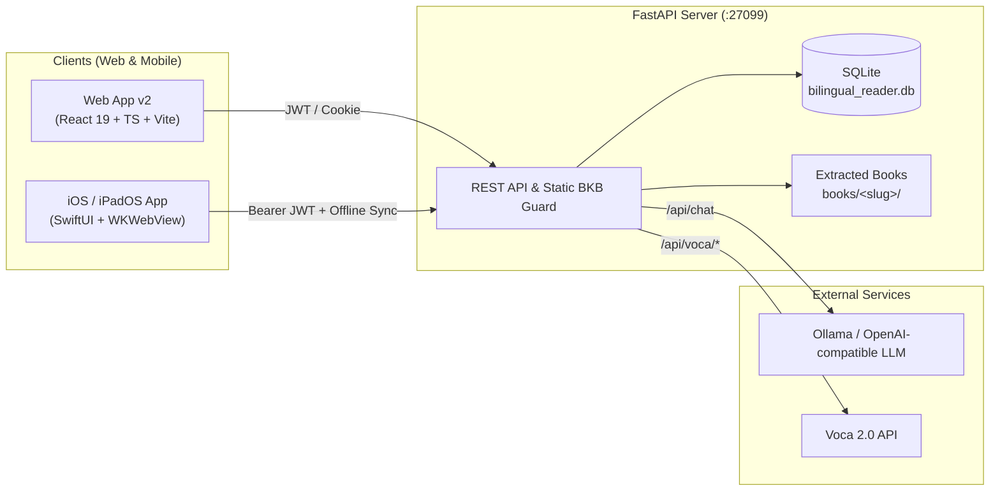

<div align="center">

# 📚 Bilingual Reader

**Hệ thống Thư viện & Đọc sách Song ngữ (Anh – Việt) đa nền tảng tích hợp AI & Từ điển Voca**

[](https://github.com/thaonv7995/bilingual-app/releases)
[](https://github.com/thaonv7995/bilingual-app/actions)
[](application/backend)
[](application/web-app-v2)
[](application/mobile_ios)

</div>

---

## ✨ Tính năng nổi bật

- **Đọc song ngữ chuẩn trang A4 (`Split` / `EN` / `VI`)**: Hiển thị song song nguyên bản tiếng Anh và bản dịch tiếng Việt từ gói sách `.bkb`, đồng bộ cuộn và vị trí trang theo thời gian thực giữa các thiết bị.
- **Tùy chỉnh Giao diện & Phông chữ theo từng sách (`Aa`)**:
  - **17 phông chữ chọn lọc**: *Serif* (`Literata`, `Merriweather`, `Lora`, `Noto Serif`, `Charter`), *Sans* (`Inter`, `Plus Jakarta Sans`, `Be Vietnam Pro`, `System Sans`), *Viết tay* (`Caveat`, `Patrick Hand`, `Dancing Script`, `Kalam`, `Mali`) và *Monospace* (`JetBrains Mono`, `Courier Prime`).
  - **Màu giấy, Màu chữ & Vân giấy**: 10 tông màu giấy, 8 màu mực in, bảng chọn màu tùy chỉnh (`Color Picker`) cùng 7 hiệu ứng chất liệu giấy (*Trơn mịn*, *Giấy nhám nhẹ*, *Vải lanh*, *Giấy cổ điển*, *Giấy Kraft*, *Chấm bi*, *Kẻ ngang*).
  - **Bảo vệ khung trang A4 (`Max A4`)**: Tùy chỉnh cỡ chữ (`80%–140%`), giãn dòng và lề trang kèm cơ chế tự động phát hiện và chặn tràn chữ khỏi khổ giấy A4.
  - Hỗ trợ lưu cấu hình riêng khi đang đọc hoặc đặt làm mặc định cho từng cuốn sách.
- **Hệ sinh thái học tập thông minh**:
  - **Highlight đa sắc**: Tô sáng câu/đoạn văn bản và đồng bộ tức thì lên máy chủ theo từng tài khoản.
  - **Từ điển & Flashcard Voca 2.0**: Tra từ, nghe phát âm, lưu từ vựng vào bộ thẻ học tập qua Voca API Proxy an toàn.
  - **Trợ lý AI (AI Assistant)**: Giải thích ngữ cảnh, dịch thuật và hỏi đáp trực tiếp dựa trên đoạn văn đang đọc.
  - **Audiobook**: Nghe sách nói đồng bộ theo từng trang đọc.
- **Đa nền tảng (Web PWA, iOS & iPadOS)**: Trải nghiệm đồng nhất giữa trình duyệt Web (`application/web-app-v2`) và ứng dụng gốc SwiftUI trên iPhone & iPad (`application/mobile_ios`) với chế độ tải sách đọc ngoại tuyến.

---

## 🏛️ Kiến trúc & Cấu trúc Dự án



```text
bilingual-app/
├── server.py                      # Entrypoint khởi chạy nhanh FastAPI server (cổng 27099)
├── deploy.sh                      # Script cài đặt/cập nhật tự động qua systemd trên Linux
├── books/                         # Thư mục lưu các gói sách .bkb đã giải nén
└── application/
    ├── backend/                   # FastAPI server, SQLite ORM, Auth, Book Ingest, AI & Voca Proxy
    ├── web-app-v2/                # Ứng dụng Web hiện đại (React 19, TypeScript, Vite, PWA)
    ├── mobile_ios/                # Ứng dụng gốc iOS & iPadOS (SwiftUI + XcodeGen)
    └── docs/                      # Tài liệu tích hợp kỹ thuật (Voca 2.0, kiến trúc dữ liệu)
```

---

## 🚀 Khởi chạy nhanh (Local Development)

### 1. Backend (FastAPI — Python 3.10+)

```bash
cd application
python3 -m venv .venv
source .venv/bin/activate
pip install -r backend/requirements-api.txt
pip install -e backend
cd ..

# Khởi động server tại http://localhost:27099
python3 server.py
```

### 2. Web Frontend v2 (Node.js 22+)

Khi phát triển giao diện Web với Vite HMR (hoặc build bản tĩnh để FastAPI phục vụ trực tiếp):

```bash
cd application/web-app-v2
npm install

# Chạy môi trường dev (HMR)
npm run dev

# Hoặc build bản production vào application/web-app-v2/dist
npm run build
```

### 3. Ứng dụng iOS & iPadOS (SwiftUI)

Dự án sử dụng [XcodeGen](https://github.com/yonaskolb/XcodeGen) để quản lý cấu hình Xcode gọn nhẹ:

```bash
cd application/mobile_ios
xcodegen generate
open BilingualReader.xcodeproj
```

---

## 📦 Triển khai Production (Linux Server)

Ứng dụng cung cấp script [`deploy.sh`](deploy.sh) tự động cài đặt và đăng ký dịch vụ chạy nền `systemd` trên cổng `27099`.

### ⚡ Cài đặt từ GitHub Release (1 lệnh — Khuyến nghị)

Bản Release đã đóng gói sẵn giao diện `web-app-v2/dist`, **không yêu cầu cài đặt Node.js trên máy chủ**:

```bash
curl -sSL https://raw.githubusercontent.com/thaonv7995/bilingual-app/main/deploy.sh | bash -s -- install-release /opt/bilingual-app
```

- **Cập nhật phiên bản mới**: Chạy lại đúng lệnh trên.
- **Gỡ cài đặt**:
  ```bash
  curl -sSL https://raw.githubusercontent.com/thaonv7995/bilingual-app/main/deploy.sh | bash -s -- delete /opt/bilingual-app
  ```

<details>
<summary><b>Phương án thay thế: Triển khai trực tiếp từ mã nguồn (Git Clone + Build)</b></summary>

```bash
# Cài đặt mới từ nhánh main
curl -sSL https://raw.githubusercontent.com/thaonv7995/bilingual-app/main/deploy.sh | bash -s -- install /opt/bilingual-app https://github.com/thaonv7995/bilingual-app.git

# Kéo code mới, build lại frontend và khởi động lại dịch vụ
curl -sSL https://raw.githubusercontent.com/thaonv7995/bilingual-app/main/deploy.sh | bash -s -- update /opt/bilingual-app
```
</details>

| Hệ điều hành | Hỗ trợ `deploy.sh` | Ghi chú |
| :--- | :---: | :--- |
| **Debian / Ubuntu** (`apt`) | ✅ | Hỗ trợ mặc định, tự động cài đặt gói phụ thuộc |
| **Fedora / RHEL / CentOS** (`dnf` / `yum`) | ✅ | Tự động cấu hình Python & systemd |
| **Arch Linux** (`pacman`) / **openSUSE** (`zypper`) | ✅ | Tự động cấu hình qua trình quản lý gói tương ứng |
| **macOS / Windows** | ➖ | Khởi chạy trực tiếp bằng `python3 server.py` hoặc qua WSL |

> Xem chi tiết hướng dẫn vận hành và CI/CD tại [application/backend/docs/DEPLOYMENT.md](application/backend/docs/DEPLOYMENT.md).

---

## ⚙️ Cấu hình & Bảo mật

### Biến môi trường (`.env`)

Tạo file `.env` tại thư mục cài đặt (tham khảo [`application/.env.example`](application/.env.example)):

| Biến môi trường | Mô tả | Mặc định |
| :--- | :--- | :--- |
| `VOCA_API_ORIGIN` | Địa chỉ HTTPS của dịch vụ Voca 2.0 | `https://voca.thaonv.online` |
| `VOCA_BRIDGE_TOKEN` | Khóa API Voca mặc định phía server (`voca_...`) | *(Trống — người dùng có thể tự cấu hình trong Settings)* |
| `OPENAI_API_KEY` | Khóa API tùy chọn cho dịch vụ LLM bên ngoài | *(Trống)* |

### Cơ chế Xác thực & Phân quyền
- **JWT Access & Refresh Token**: Access Token ngắn hạn kết hợp Refresh Token luân chuyển tự động qua HTTP-Only Cookie (Web) hoặc Bearer Header (iOS).
- **Cô lập dữ liệu đa người dùng (Multi-tenant Isolation)**: Tiến trình đọc, tùy chỉnh giao diện (`reader_font`, `reader_theme`), highlight và cấu hình AI/Voca được tách biệt hoàn toàn theo từng `user_id`.
- **Bảo vệ tài nguyên sách (`.bkb`)**: Mọi truy cập tĩnh vào `/books/<slug>/*` đều được kiểm tra quyền đọc (`user_permissions`) hoặc trạng thái xuất bản trước khi phục vụ.
- **Service API Key (`X-API-Key`)**: Hỗ trợ khóa API riêng cho các công cụ đóng gói sách tự động đẩy file `.bkb` lên thư viện.

---

## 🧪 Kiểm thử (Testing)

```bash
# Chạy bộ kiểm thử Backend (pytest)
cd application/backend
../.venv/bin/pytest -q

# Chạy bộ kiểm thử & kiểm tra kiểu dữ liệu Frontend Web v2
cd application/web-app-v2
npm test
npm run typecheck
```

---

## 📄 Giấy phép (License)

Dự án được phát hành phục vụ mục đích học tập và nghiên cứu. Mọi đóng góp (Pull Requests & Issues) đều được hoan nghênh!
